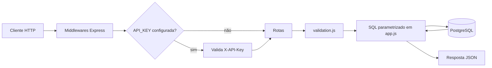
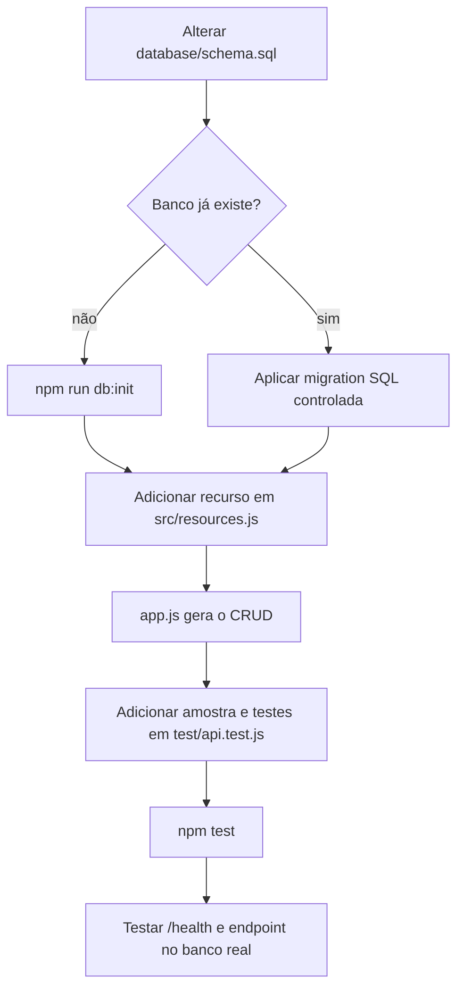
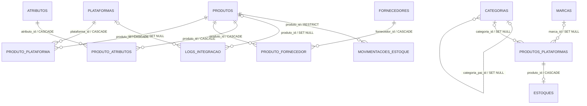

# Guia do ambiente, endpoints e banco de dados

Este documento descreve como copiar o projeto para outra máquina, executá-lo no Windows ou Ubuntu, criar endpoints seguindo a arquitetura atual e entender o banco PostgreSQL.

## 1. Visão geral

Tecnologias e requisitos:

- Node.js 22 ou superior;
- npm;
- PostgreSQL;
- Git;
- Express 5 e driver `pg`;
- arquivo `.env` local com as credenciais do banco.

Estrutura principal:

```text
backend_bolivaseletroinfo/
├── database/
│   └── schema.sql          # criação das 13 tabelas, índices e relacionamentos
├── public/images/          # arquivos publicados pela rota /images
├── scripts/
│   └── init-db.js          # aplica o schema em um banco vazio
├── src/
│   ├── app.js              # middlewares, rotas CRUD e tratamento de erros
│   ├── db.js               # pool de conexões PostgreSQL
│   ├── image-catalog.js    # catálogo de imagens por categoria
│   ├── resources.js        # recursos, campos, tipos e relacionamentos da API
│   ├── server.js           # valida o banco e inicia o servidor HTTP
│   └── validation.js       # valida corpo, IDs, filtros e paginação
├── test/
│   └── api.test.js         # testes HTTP com banco simulado
├── .env.example
└── package.json
```

Fluxo da aplicação:



## 2. Clonar o código em outra máquina

O repositório remoto configurado atualmente é:

```text
git@github.com:VitorHugo858/BolivasEletroMarket_Backend.git
```

Escolha uma das formas de clonagem.

### Com SSH

Requer uma chave SSH cadastrada na conta do GitHub:

```bash
git clone git@github.com:VitorHugo858/BolivasEletroMarket_Backend.git
cd BolivasEletroMarket_Backend
```

### Com HTTPS

```bash
git clone https://github.com/VitorHugo858/BolivasEletroMarket_Backend.git
cd BolivasEletroMarket_Backend
```

> O Git copia o código e as imagens versionadas, mas não copia o arquivo `.env` nem os dados existentes no PostgreSQL.

## 3. Instalação no Windows

Instale Git, Node.js 22+ e PostgreSQL. Depois, no PowerShell:

```powershell
git clone https://github.com/VitorHugo858/BolivasEletroMarket_Backend.git
Set-Location BolivasEletroMarket_Backend
npm.cmd ci
Copy-Item .env.example .env
```

Edite `.env` e configure o banco conforme a seção 5. O uso de `npm.cmd` evita bloqueios que algumas políticas do PowerShell aplicam ao arquivo `npm.ps1`.

Para iniciar:

```powershell
npm.cmd run dev
```

Para executar os testes:

```powershell
npm.cmd test
```

## 4. Instalação no Ubuntu

### 4.1 Dependências do sistema

```bash
sudo apt update
sudo apt install -y git curl postgresql postgresql-client
```

Instale o Node.js 22 ou superior. Um modo simples para ambiente de desenvolvimento é o `nvm`:

```bash
curl -o- https://raw.githubusercontent.com/nvm-sh/nvm/v0.40.8/install.sh | bash
source "$HOME/.nvm/nvm.sh"
nvm install 22
nvm use 22
node --version
npm --version
```

O comando de instalação acima acompanha a versão indicada na [documentação oficial do nvm](https://github.com/nvm-sh/nvm#installing-and-updating).

> Em servidor de produção, fixe e mantenha a versão do Node por meio do gerenciador adotado pela equipe. Não execute a API como `root`.

### 4.2 Clonar e instalar o projeto

```bash
git clone https://github.com/VitorHugo858/BolivasEletroMarket_Backend.git
cd BolivasEletroMarket_Backend
npm ci
cp .env.example .env
chmod 600 .env
```

`npm ci` instala exatamente as versões registradas em `package-lock.json`. Use `npm install` somente quando quiser atualizar o lockfile ou adicionar uma dependência.

### 4.3 Criar usuário e banco no PostgreSQL

Abra o console administrativo:

```bash
sudo -u postgres psql
```

No prompt do PostgreSQL, crie um usuário e um banco. Substitua a senha do exemplo:

```sql
CREATE USER bolivas_app WITH PASSWORD 'troque-por-uma-senha-forte';
CREATE DATABASE bolivas_eletroinfo OWNER bolivas_app;
\q
```

Edite o `.env`:

```dotenv
NODE_ENV=development
HOST=127.0.0.1
PORT=3000

PGHOST=localhost
PGPORT=5432
PGDATABASE=bolivas_eletroinfo
PGUSER=bolivas_app
PGPASSWORD=troque-por-uma-senha-forte
PGSSL=false

API_KEY=
```

Para um banco novo e vazio, crie as tabelas uma única vez:

```bash
npm run db:init
```

Inicie e valide a aplicação:

```bash
npm run dev
```

Em outro terminal:

```bash
curl http://127.0.0.1:3000/health
```

Resposta esperada:

```json
{"status":"ok","database":"ok"}
```

Se `API_KEY` estiver preenchida, inclua-a também no teste:

```bash
curl -H 'X-API-Key: sua-chave' http://127.0.0.1:3000/health
```

## 5. Configuração do ambiente

| Variável | Exemplo | Função |
| --- | --- | --- |
| `NODE_ENV` | `development` | identifica o ambiente de execução |
| `HOST` | `127.0.0.1` | interface em que a API escuta |
| `PORT` | `3000` | porta HTTP, de 1 a 65535 |
| `PGHOST` | `localhost` | endereço do PostgreSQL |
| `PGPORT` | `5432` | porta do PostgreSQL |
| `PGDATABASE` | `bolivas_eletroinfo` | nome do banco |
| `PGUSER` | `bolivas_app` | usuário do banco |
| `PGPASSWORD` | senha local | senha do banco |
| `PGSSL` | `false` | use `true` apenas quando o servidor exigir TLS com certificado válido |
| `API_KEY` | valor secreto | se preenchida, protege `/api` e `/health` via `X-API-Key` |

Regras importantes:

- nunca envie `.env` ao Git; somente `.env.example` deve ser versionado;
- `HOST=127.0.0.1` permite acesso apenas na própria máquina;
- para receber conexões da rede, pode-se usar `HOST=0.0.0.0`, mas isso deve ser acompanhado por firewall, `API_KEY`, proxy HTTPS e controle de acesso;
- o pool usa no máximo 10 conexões, timeout de conexão de 5 segundos e timeout de consulta de 10 segundos;
- a API não configura CORS.

## 6. Banco novo versus cópia do banco existente

### Criar somente a estrutura

Use esta opção quando a nova instalação deve começar vazia:

```bash
npm run db:init
```

O comando executa `database/schema.sql` dentro de uma transação. Ele não apaga, não atualiza e não migra tabelas existentes. Se alguma tabela já existir, a operação falha e é revertida.

### Copiar estrutura e dados existentes

Na máquina de origem, gere um backup no formato customizado:

```bash
pg_dump -h localhost -U postgres -d bolivas_eletroinfo -F c -f bolivas_eletroinfo.dump
```

Transfira o arquivo `bolivas_eletroinfo.dump` por um meio seguro. Na máquina de destino, crie um banco vazio e restaure:

```bash
createdb -h localhost -U postgres bolivas_eletroinfo
pg_restore -h localhost -U postgres -d bolivas_eletroinfo --no-owner bolivas_eletroinfo.dump
```

Neste caso, **não** execute `npm run db:init`, pois o backup já contém a estrutura. Faça o backup durante uma janela consistente com a política operacional do banco e proteja o arquivo, porque ele pode conter dados sensíveis.

## 7. Comandos do projeto

| Comando | Descrição |
| --- | --- |
| `npm run dev` | inicia com reinício automático ao alterar código |
| `npm start` | inicia sem modo de observação |
| `npm test` | executa os testes com `node:test` e banco simulado |
| `npm run db:init` | cria o schema em um banco vazio |

## 8. Como os endpoints atuais são criados

O projeto usa uma fábrica de CRUD. Cada entrada exportada por `src/resources.js` gera automaticamente estas cinco rotas em `src/app.js`:

| Método | Rota | Operação |
| --- | --- | --- |
| `GET` | `/api/<recurso>?page=1&limit=20` | lista registros |
| `GET` | `/api/<recurso>/:id` | consulta por ID |
| `POST` | `/api/<recurso>` | cria e retorna `201` |
| `PUT`/`PATCH` | `/api/<recurso>/:id` | atualização parcial |
| `DELETE` | `/api/<recurso>/:id` | exclusão física e retorno `204` |

Apesar do nome `PUT`, `PUT` e `PATCH` têm a mesma semântica parcial neste projeto: somente os campos enviados são alterados.



### 8.1 Criar um CRUD para uma tabela nova

Exemplo: tabela `transportadoras`.

#### Passo 1 — criar a tabela

Para uma instalação nova, acrescente ao schema:

```sql
CREATE TABLE public.transportadoras (
    id bigserial PRIMARY KEY,
    nome varchar(150) NOT NULL,
    ativo boolean DEFAULT true,
    criado_em timestamp DEFAULT CURRENT_TIMESTAMP
);
```

Se o banco já estiver em uso, não rode novamente o `schema.sql`. Crie e versione uma migration específica, revise backup/rollback e aplique-a no ambiente de destino.

#### Passo 2 — declarar o recurso

Em `src/resources.js`, adicione uma entrada ao objeto `resources`:

```js
transportadoras: {
  fields: {
    nome: text(150, true),
    ativo: bool,
  },
},
```

O nome da chave deve corresponder exatamente à tabela. Não inclua `id`, `criado_em` ou outros campos gerenciados pelo banco/API em `fields`.

Tipos disponíveis no arquivo:

| Helper/tipo | Uso |
| --- | --- |
| `text(tamanho, obrigatório)` | `varchar` ou `text`; omita o tamanho para texto livre |
| `id(obrigatório)` | chave estrangeira bigint positiva |
| `bool` | booleano JSON verdadeiro/falso |
| `integer` | inteiro PostgreSQL de 32 bits |
| `decimal(precisão, escala)` | campo `numeric`; aceita número ou string decimal |
| `timestamp` | texto no formato `AAAA-MM-DDTHH:mm:ss` sem fuso |

O segundo argumento `true` de `text` ou `id` torna o campo obrigatório no `POST`. Um campo opcional pode receber `null`; um obrigatório não pode.

#### Passo 3 — testar

Acrescente uma amostra ao objeto `samples` de `test/api.test.js`:

```js
transportadoras: { nome: 'Transportadora teste' },
```

O laço de testes existente passa a verificar automaticamente POST, GET, listagem, PUT, PATCH e DELETE do novo recurso. Inclua testes adicionais para regras específicas.

Execute:

```bash
npm test
```

#### Passo 4 — testar manualmente

```bash
curl -X POST http://127.0.0.1:3000/api/transportadoras \
  -H 'Content-Type: application/json' \
  -d '{"nome":"Transportadora teste","ativo":true}'

curl 'http://127.0.0.1:3000/api/transportadoras?page=1&limit=20'
```

### 8.2 Criar relacionamento e rota contextual

Exemplo: se `produtos` recebesse `transportadora_id`, a definição seria semelhante a:

```js
produtos: {
  foreignKeys: { transportadora_id: 'transportadoras' },
  fields: {
    // campos atuais...
    transportadora_id: id(),
  },
},
```

Isso habilitaria automaticamente:

```text
GET /api/produtos?transportadora_id=10
GET /api/transportadoras/10/produtos
```

Antes disso, a coluna e sua `FOREIGN KEY` precisam existir no PostgreSQL. `foreignKeys` controla os filtros e as rotas contextuais, enquanto `fields` controla o que pode ser enviado em POST/PUT/PATCH.

### 8.3 Criar endpoint com regra própria

Para uma operação que não seja CRUD simples — por exemplo, reservar estoque em uma transação — crie a rota explicitamente em `src/app.js`, antes do middleware de rota não encontrada:

```js
app.post('/api/estoques/:id/reservar', async (req, res) => {
  const id = validateId(req.params.id);
  // Validar o corpo, abrir transação, bloquear/atualizar o registro
  // e retornar uma resposta adequada.
  res.status(501).json({ error: `Reserva do estoque ${id} ainda não implementada.` });
});
```

Ao implementar de verdade:

- valide todos os dados antes de acessar o banco;
- use placeholders (`$1`, `$2`...) e nunca concatene valores fornecidos pelo cliente;
- use uma conexão obtida por `db.connect()` quando precisar de `BEGIN`, `COMMIT` e `ROLLBACK` na mesma sessão;
- trate concorrência de estoque de forma atômica;
- lance `HttpError` para erros HTTP esperados;
- adicione casos de sucesso, validação, ausência e conflito em `test/api.test.js`.

## 9. Recursos já expostos

| Recurso | Campos obrigatórios no POST | Filtros de relacionamento |
| --- | --- | --- |
| `atributos` | `nome` | — |
| `categorias` | `nome` | `categoria_pai_id` |
| `estoques` | `produto_id` | `produto_id` |
| `fornecedores` | `nome` | — |
| `logs_integracao` | nenhum | `plataforma_id`, `produto_id` |
| `marcas` | `nome` | — |
| `movimentacoes_estoque` | `produto_id`, `tipo`, `quantidade` | `produto_id` |
| `plataformas` | `nome` | — |
| `produto_atributos` | `produto_id`, `atributo_id`, `valor` | `produto_id`, `atributo_id` |
| `produto_fornecedor` | `produto_id`, `fornecedor_id` | `produto_id`, `fornecedor_id` |
| `produto_plataforma` | `produto_id`, `plataforma_id` | `produto_id`, `plataforma_id` |
| `produtos` | nenhum | — |
| `produtos_plataformas` | `codigo`, `descricao` | `categoria_id`, `marca_id` |

Listagens aceitam `page` (padrão 1), `limit` (padrão 20, máximo 100) e apenas os filtros declarados para o recurso. Todos os filtros enviados são combinados com `AND`.

## 10. Organograma do banco de dados

### 10.1 Visão dos relacionamentos



Legenda:

- `||`: exatamente um;
- `o|`: zero ou um;
- `o{`: zero ou muitos;
- `CASCADE`: exclui automaticamente os registros filhos;
- `SET NULL`: preserva o filho e limpa a referência;
- `RESTRICT`: impede a exclusão do pai enquanto houver filhos.

### 10.2 Entidades e campos

```mermaid
erDiagram
    ATRIBUTOS {
        bigint id PK
        varchar nome
        varchar tipo
        varchar unidade
        boolean ativo
    }

    CATEGORIAS {
        bigint id PK
        varchar nome
        text descricao
        bigint categoria_pai_id FK
        boolean ativo
        timestamp criado_em
        timestamp atualizado_em
    }

    FORNECEDORES {
        bigint id PK
        varchar nome
        varchar razao_social
        varchar cnpj
        varchar email
        varchar telefone
        varchar cidade
        varchar estado
        boolean ativo
        timestamp criado_em
    }

    MARCAS {
        bigint id PK
        varchar nome UK
        boolean ativo
        timestamp criado_em
    }

    PLATAFORMAS {
        bigint id PK
        varchar nome UK
        boolean ativo
        timestamp criado_em
    }

    PRODUTOS {
        bigint id PK
        integer codigo
        varchar descricao
        varchar marca
        integer preco
        varchar saldo
    }

    PRODUTOS_PLATAFORMAS {
        bigint id PK
        varchar codigo UK
        varchar codigo_barras
        varchar descricao
        text descricao_completa
        bigint categoria_id FK
        bigint marca_id FK
        varchar modelo
        varchar unidade
        numeric peso
        numeric altura
        numeric largura
        numeric comprimento
        boolean ativo
        timestamp criado_em
        timestamp atualizado_em
        numeric preco
    }

    ESTOQUES {
        bigint id PK
        bigint produto_id FK,UK
        numeric quantidade
        numeric reservado
        numeric estoque_minimo
        numeric estoque_maximo
        timestamp atualizado_em
    }

    LOGS_INTEGRACAO {
        bigint id PK
        bigint plataforma_id FK
        bigint produto_id FK
        varchar tipo
        varchar status
        text mensagem
        timestamp criado_em
    }

    MOVIMENTACOES_ESTOQUE {
        bigint id PK
        bigint produto_id FK
        varchar tipo
        numeric quantidade
        numeric saldo_anterior
        numeric saldo_posterior
        varchar referencia
        text observacao
        timestamp criado_em
    }

    PRODUTO_ATRIBUTOS {
        bigint id PK
        bigint produto_id FK
        bigint atributo_id FK
        varchar valor
    }

    PRODUTO_FORNECEDOR {
        bigint id PK
        bigint produto_id FK
        bigint fornecedor_id FK
        varchar codigo_fornecedor
        numeric preco_custo
        boolean principal
    }

    PRODUTO_PLATAFORMA {
        bigint id PK
        bigint produto_id FK
        bigint plataforma_id FK
        varchar codigo_externo
        varchar titulo_externo
        numeric preco
        numeric quantidade_publicada
        boolean ativo
        boolean sincronizado
        timestamp ultima_sincronizacao
        timestamp criado_em
    }
```



### 10.3 Restrições relevantes

- `marcas.nome`, `plataformas.nome` e `produtos_plataformas.codigo` são únicos;
- `estoques.produto_id` é único: cada item de `produtos_plataformas` tem no máximo um registro de estoque;
- as duplas `(produto_id, atributo_id)`, `(produto_id, fornecedor_id)` e `(produto_id, plataforma_id)` são únicas nas respectivas tabelas de associação;
- `movimentacoes_estoque.tipo` aceita somente `ENTRADA`, `VENDA`, `DEVOLUCAO`, `AJUSTE_POSITIVO`, `AJUSTE_NEGATIVO` e `TRANSFERENCIA`;
- `produtos.codigo` e `produtos.descricao` possuem índices;
- registrar uma movimentação não altera `estoques` automaticamente: o schema e a API atual não implementam essa regra de negócio.

## 11. Atenção aos dois cadastros de produto

O banco contém duas tabelas independentes:

- `produtos`: cadastro legado/simplificado, relacionado a movimentações, atributos, fornecedores, plataformas e logs;
- `produtos_plataformas`: cadastro detalhado, relacionado a categorias, marcas e estoque.

Não há chave estrangeira ligando essas duas tabelas. Em particular:

- `estoques.produto_id` aponta para `produtos_plataformas.id`;
- as demais tabelas que possuem `produto_id` apontam para `produtos.id`.

Essa separação deve ser considerada antes de implementar sincronização, vendas ou baixa automática de estoque.

## 12. Checklist de entrega em outra máquina

- [ ] Git, Node.js 22+, npm e PostgreSQL instalados;
- [ ] repositório clonado;
- [ ] dependências instaladas com `npm ci`;
- [ ] `.env` criado localmente e protegido;
- [ ] banco vazio inicializado **ou** backup existente restaurado;
- [ ] `npm test` concluído sem falhas;
- [ ] `/health` retornando banco disponível;
- [ ] `API_KEY` e HTTPS configurados se houver acesso fora da máquina;
- [ ] porta liberada somente para as origens necessárias;
- [ ] processo configurado para reiniciar e registrar logs no ambiente de produção.
